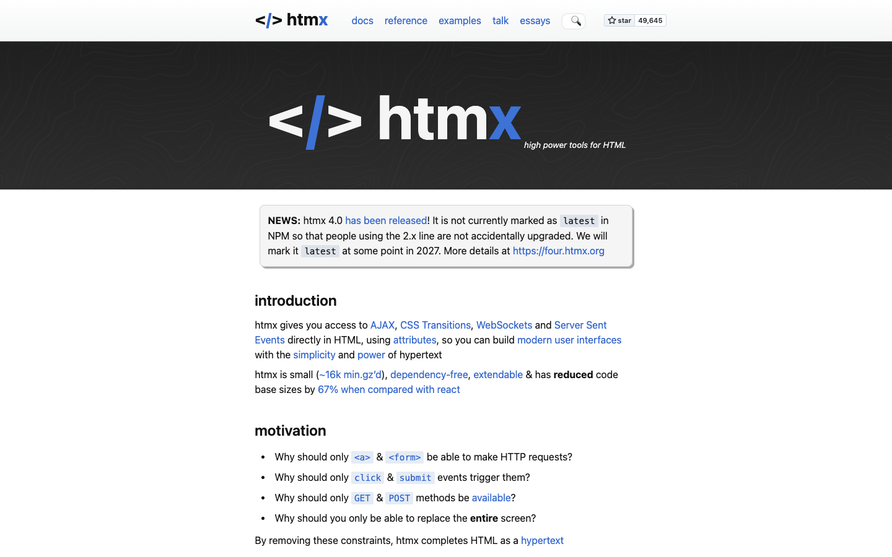
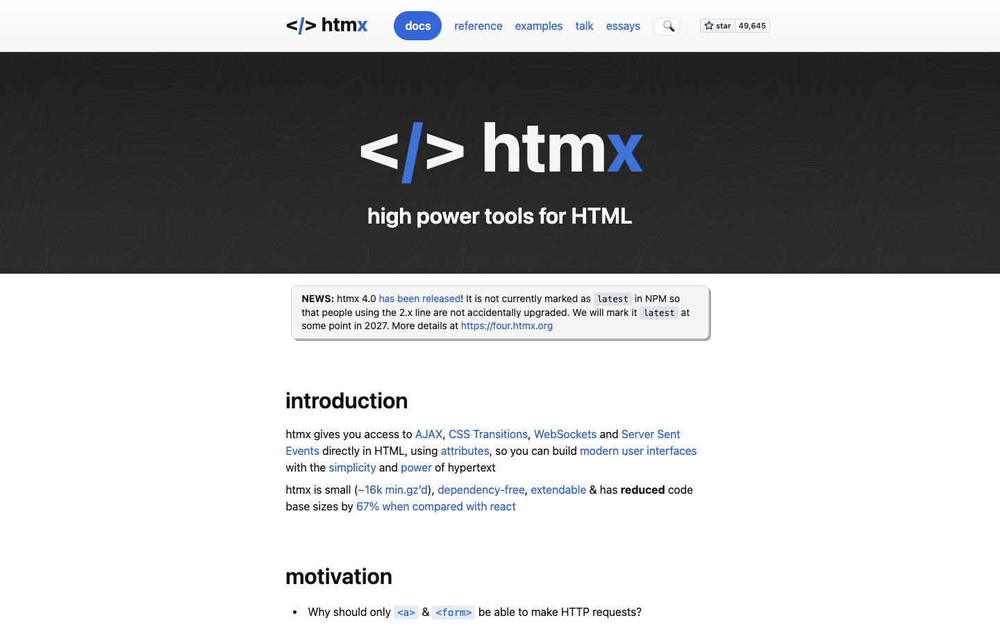

# 改后验收清单

- 页面：https://htmx.org/
- 方式：在真实页面里套上 `patch.css`，用浏览器重新量每条的「怎么看改对了」。**只在浏览器里临时套样式预览，没有改线上网站。**

| 条目 | 检查 | 目标 | 改前 | 改后 | 结果 |
|---|---|---|---|---|---|
| P0-1 把一句话说明做成首屏最大的文字 | `.dark-hero .main sub` fontSize（一句话说明字号） | >= 28 | 13.3333px | 32px | ✅ 通过 |
| P0-1 把一句话说明做成首屏最大的文字 | `.dark-hero .main sub i` fontStyle（不斜体） | == normal | italic | normal | ✅ 通过 |
| P0-2 把 docs 做成首页唯一的实心按钮 | `.top-nav a[href="/docs/"]` backgroundColor（有底色） | != rgba(0, 0, 0, 0) | rgba(0, 0, 0, 0) | rgb(52, 101, 217) | ✅ 通过 |
| P0-2 把 docs 做成首页唯一的实心按钮 | `.top-nav a[href="/docs/"]` borderRadius（胶囊圆角） | >= 16 | 0px | 999px | ✅ 通过 |
| P0-2 把 docs 做成首页唯一的实心按钮 | `.top-nav a[href="/docs/"]` rect.height（高度） | >= 32 | 18 | 42 | ✅ 通过 |
| P1-1 首屏横幅加高，让一句话周围有空气 | `.dark-hero` rect.height（横幅高度） | >= 320 | 240 | 320 | ✅ 通过 |
| P1-2 章节标题放大并拉开章节间距 | `main.c.content > h2:nth-of-type(1)` fontSize（h2 字号） | >= 32 | 24px | 32px | ✅ 通过 |
| P1-2 章节标题放大并拉开章节间距 | `main.c.content > h2:nth-of-type(2)` marginTop（章节上外边距） | >= 64 | 42px | 72px | ✅ 通过 |
| P2-1 新闻框收小，别抢在介绍前面 | `main.c.content .alert` rect.height（新闻框高度） | <= 90 | 100 | 76.8 | ✅ 通过 |

**合计：9/9 项通过。** 看不出数字的条目（观感类）见改版清单里的「人工看」一栏，要自己对着 mine-after-top.png 看。

