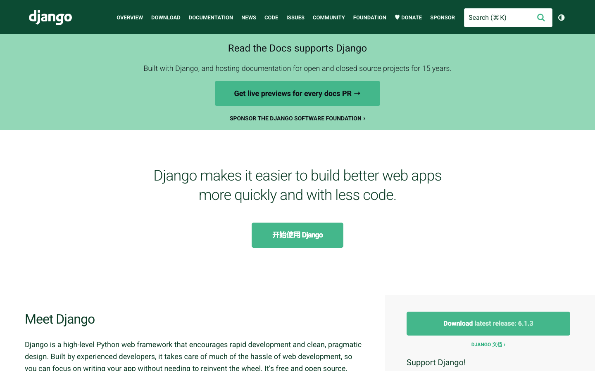
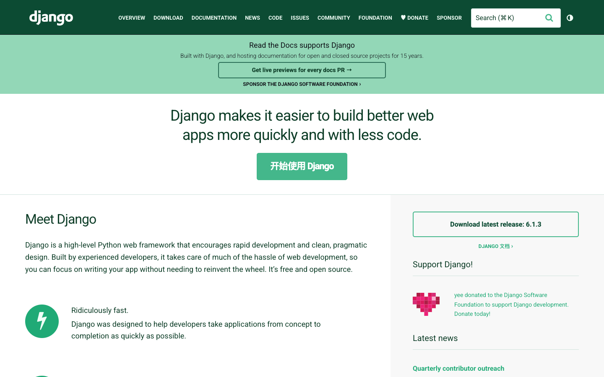

# 改后验收清单

- 页面：https://www.djangoproject.com/
- 方式：在真实页面里套上 `patch.css`，用浏览器重新量每条的「怎么看改对了」。**只在浏览器里临时套样式预览，没有改线上网站。**

| 条目 | 检查 | 目标 | 改前 | 改后 | 结果 |
|---|---|---|---|---|---|
| P0-1 赞助横幅按钮降级成描边次按钮 | `#banner-cta` backgroundColor（透明底） | == rgba(0, 0, 0, 0) | rgb(68, 183, 139) | rgba(0, 0, 0, 0) | ✅ 通过 |
| P0-1 赞助横幅按钮降级成描边次按钮 | `#banner-cta` borderTopWidth（描边粗细） | >= 2 | 0px | 2px | ✅ 通过 |
| P0-2 右侧 Download 也降成描边 | `[role=complementary] > a.cta` backgroundColor（透明底） | == rgba(0, 0, 0, 0) | rgb(68, 183, 139) | rgba(0, 0, 0, 0) | ✅ 通过 |
| P0-2 右侧 Download 也降成描边 | `[role=complementary] > a.cta` borderTopWidth（描边粗细） | >= 2 | 0px | 2px | ✅ 通过 |
| P0-2 右侧 Download 也降成描边 | `[role=complementary] > a.cta em` color（em 文字不是白色） | == rgb(12, 75, 51) | rgb(201, 240, 221) | rgb(12, 75, 51) | ✅ 通过 |
| P1-1 赞助横幅压成一行高，标语提前进第一屏 | `#billboard` rect.height（横幅高度） | <= 150 | 234.5 | 141.5 | ✅ 通过 |
| P1-1 赞助横幅压成一行高，标语提前进第一屏 | `.copy-banner em` rect.top（标语离页面顶） | <= 320 | 405.5 | 254.5 | ✅ 通过 |
| P1-2 标语加重、主按钮放大 | `.copy-banner em` fontWeight（标语字重） | >= 500 | 300 | 500 | ✅ 通过 |
| P1-2 标语加重、主按钮放大 | `.copy-banner p a.cta` rect.height（主按钮高） | >= 64 | 61.2 | 64.6 | ✅ 通过 |
| P1-2 标语加重、主按钮放大 | `.copy-banner p a.cta` fontSize（主按钮字号） | >= 22 | 18px | 22px | ✅ 通过 |
| P2-1 开始使用区上下收紧 | `.copy-banner` rect.height（区块高度） | <= 320 | 399.8 | 241.2 | ✅ 通过 |
| P2-1 开始使用区上下收紧 | `.copy-banner p a.cta` rect.left（主按钮仍然水平居中） | between 560~660 | 609 ✔ | 612.2 | ✅ 通过 |

**合计：12/12 项通过。** 看不出数字的条目（观感类）见改版清单里的「人工看」一栏，要自己对着 mine-after-top.png 看。

