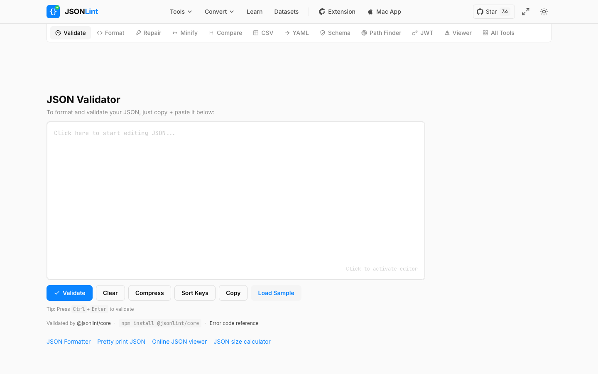
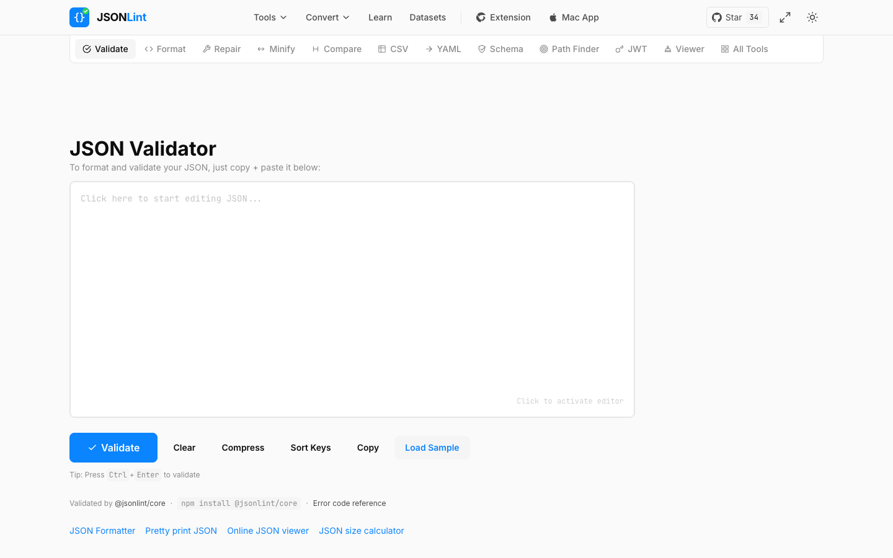

# 改后验收清单

- 页面：https://jsonlint.com/
- 方式：在真实页面里套上 `patch.css`，用浏览器重新量每条的「怎么看改对了」。**只在浏览器里临时套样式预览，没有改线上网站。**

| 条目 | 检查 | 目标 | 改前 | 改后 | 结果 |
|---|---|---|---|---|---|
| P0-1 Validate 放大，成为按钮组里最大的一个 | `button.btn.btn-primary` rect.height（Validate 高度） | >= 46 | 38 | 48 | ✅ 通过 |
| P0-1 Validate 放大，成为按钮组里最大的一个 | `button.btn.btn-primary` fontSize（Validate 字号） | >= 16 | 14px | 16px | ✅ 通过 |
| P0-2 其余按钮去掉描边，变成文字按钮 | `button.btn.btn-secondary` backgroundColor（透明底） | == rgba(0, 0, 0, 0) | rgba(0, 0, 0, 0) ✔ | rgba(0, 0, 0, 0) | ✅ 通过 |
| P0-2 其余按钮去掉描边，变成文字按钮 | `button.btn.btn-secondary` borderTopColor（透明边框） | == rgba(0, 0, 0, 0) | rgb(220, 220, 220) | rgba(0, 0, 0, 0) | ✅ 通过 |
| P0-2 其余按钮去掉描边，变成文字按钮 | `button.btn.btn-secondary` rect.height（点击区域不缩小） | >= 36 | 38 ✔ | 38 | ✅ 通过 |
| P1-1 页面标题放大加重 | `h1` fontSize（H1 字号） | >= 32 | 24px | 32px | ✅ 通过 |
| P1-1 页面标题放大加重 | `h1` fontWeight（H1 字重） | >= 700 | 700 ✔ | 700 | ✅ 通过 |
| P1-2 编辑框和按钮组之间拉开 | `div.space-y-3 > div.flex.flex-wrap` marginTop（按钮组上外边距） | >= 24 | 12px | 24px | ✅ 通过 |

**合计：8/8 项通过。** 看不出数字的条目（观感类）见改版清单里的「人工看」一栏，要自己对着 mine-after-top.png 看。

