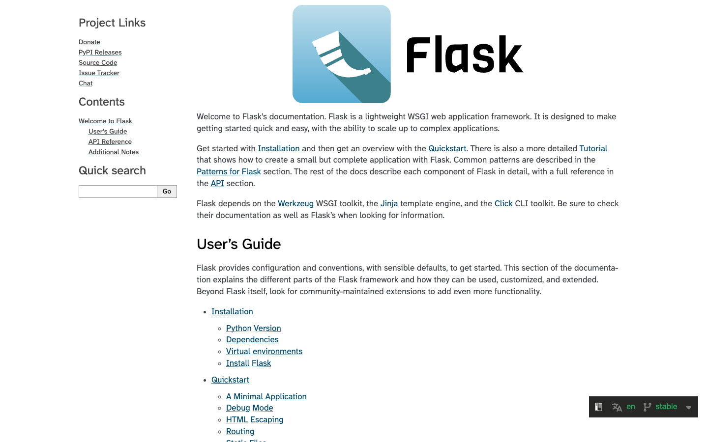
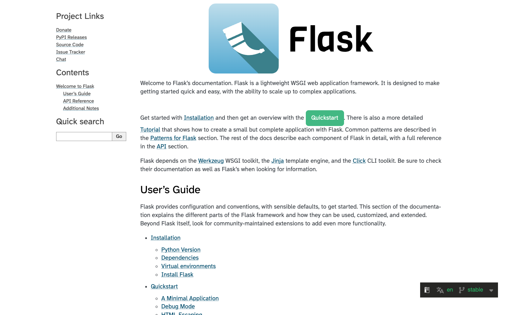

# 改后验收清单

- 页面：https://flask.palletsprojects.com/en/stable/
- 方式：在真实页面里套上 `patch.css`，用浏览器重新量每条的「怎么看改对了」。**只在浏览器里临时套样式预览，没有改线上网站。**

| 条目 | 检查 | 目标 | 改前 | 改后 | 结果 |
|---|---|---|---|---|---|
| P0-1 把 Quickstart 链接变成实心按钮（最小改法：只改样式） | `#welcome-to-flask p a[href="quickstart/"]` rect.height（参考页主按钮高 40px） | >= 40 | 18 | 45.8 | ✅ 通过 |
| P0-1 把 Quickstart 链接变成实心按钮（最小改法：只改样式） | `#welcome-to-flask p a[href="quickstart/"]` borderTopLeftRadius（参考页圆角 8px） | >= 8 | 0px | 8px | ✅ 通过 |
| P1-1 拉开第 1、2 段之间的留白 | `#welcome-to-flask > p:nth-of-type(2)` marginTop（原 17px） | >= 40 | 17px | 40px | ✅ 通过 |

**合计：3/3 项通过。** 看不出数字的条目（观感类）见改版清单里的「人工看」一栏，要自己对着 mine-after-top.png 看。

